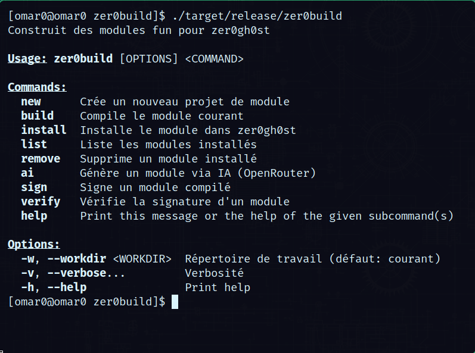
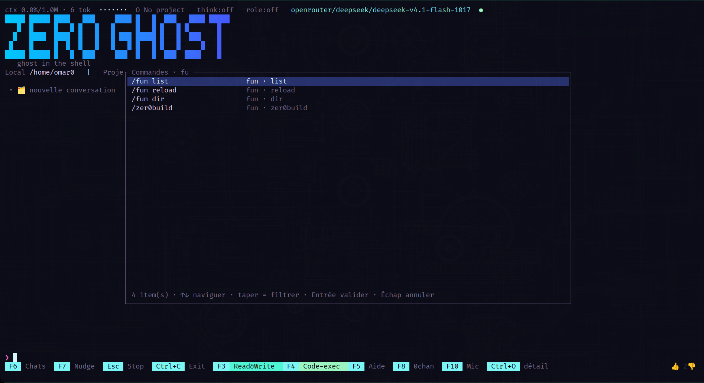
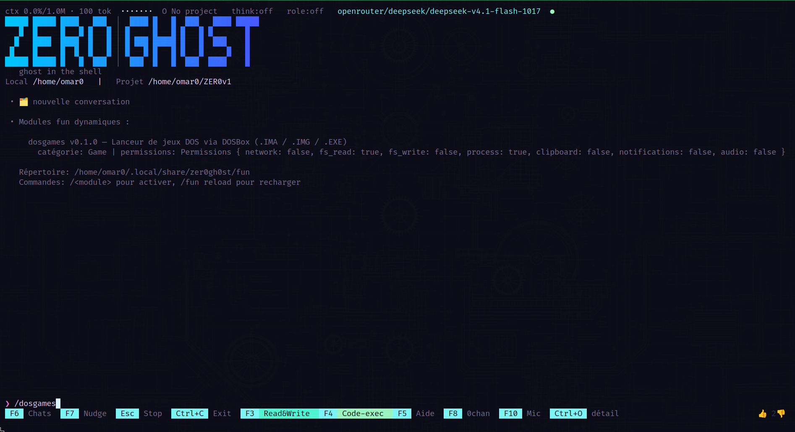
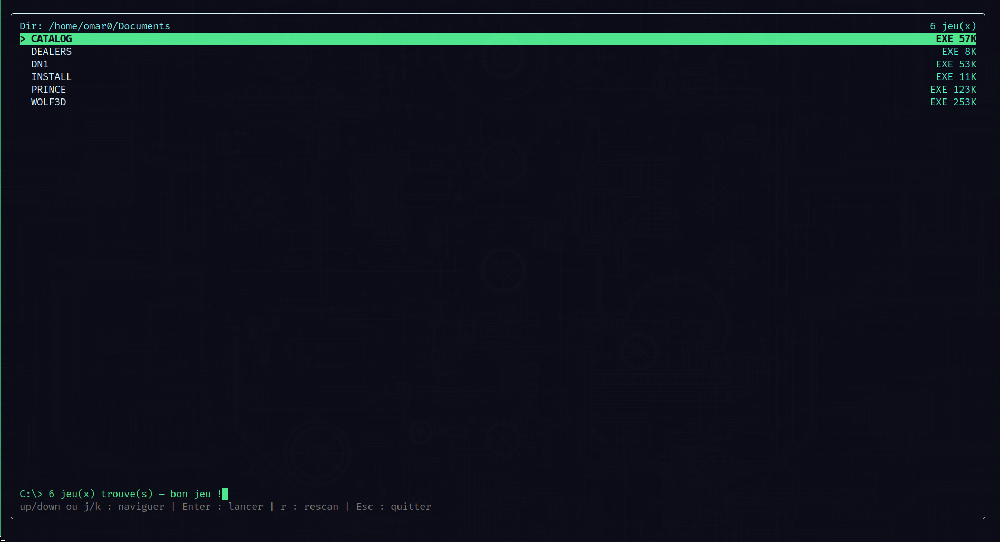

# zer0build

CLI pour créer, compiler, signer et installer des **modules fun** pour [zer0gh0st](https://github.com/Richerrail/zer0gh0st).



## Prérequis

**Installe d'abord zer0gh0st.** zer0build ne fonctionne pas seul : il s'appuie sur zer0gh0st pour deux choses essentielles :

1. **La crate `zer0fun-api`** — elle définit l'API des modules (trait `FunModule`, `Meta`, `Context`, `Event`, `Buffer`, `Permissions`…). Sans elle, impossible de compiler un module.
2. **Le mécanisme de signature** — zer0gh0st vérifie la signature Ed25519 de chaque module avant de le charger. Un module non signé est refusé.

Autres prérequis :
- Rust + Cargo (édition 2021)
- `cargo` dans le `PATH`

## Installation

### Depuis les sources (recommandé)

```bash
git clone https://github.com/Richerrail/zer0build.git
cd zer0build
cargo build --release
```

Le binaire est dans `target/release/zer0build`. Copie-le dans ton `PATH` :

```bash
# Linux / macOS
sudo cp target/release/zer0build /usr/local/bin/

# Windows (PowerShell)
Copy-Item target\release\zer0build.exe "$env:USERPROFILE\.cargo\bin\"
```

### Vérifier l'installation

```bash
zer0build --help
```

### Configuration (optionnel)

Un fichier de config peut être créé dans `~/.config/zer0build/config.toml` :

```toml
install_dir = "/home/toi/.local/share/zer0gh0st/fun"
openrouter_api_key = "sk-or-v1-..."
default_model = "anthropic/claude-3.5-sonnet"
```

La clé OpenRouter peut aussi être passée via la variable d'environnement `OPENROUTER_API_KEY`.

## Fonctionnement

```
zer0build new <nom> --template <type>   # génère un projet de module
zer0build build --release               # compile en .so
zer0build install                       # copie dans ~/.local/share/zer0gh0st/fun/ + signe
```

À l'installation, le module est copié dans le dossier `fun/` de zer0gh0st, **signé automatiquement** (Ed25519 sur hash SHA-256), puis chargé à chaud par zer0gh0st.

## Commandes

| Commande | Description |
|---|---|
| `zer0build new <nom>` | Crée un nouveau projet de module (`--template`, `--description`, `--author`) |
| `zer0build build` | Compile le module courant (`--release`, `--target`, `--all`) |
| `zer0build install` | Installe le `.so` dans le dossier fun de zer0gh0st et le signe (`--force`, `--target-dir`) |
| `zer0build list` | Liste les modules installés |
| `zer0build remove <nom>` | Désinstalle un module |
| `zer0build ai <prompt>` | Génère un module via IA (OpenRouter) |
| `zer0build sign <fichier>` | Signe un module existant |
| `zer0build verify <fichier>` | Vérifie la signature d'un module |
| `zer0build registry list` | Liste les modules d'un registre |
| `zer0build registry publish` | Publie un module dans le registre |
| `zer0build registry install` | Installe un module depuis un registre |
| `zer0build registry remove <nom>` | Retire un module d'un registre local |
| `zer0build config` | Affiche ou modifie la configuration (`--show`, `--install-dir`, `--openrouter-api-key`, `--default-model`) |

## Templates

| Template | Description |
|---|---|
| `basic` | Module minimal avec compteur |
| `game` | Jeu avec boucle et événements |
| `visual` | Visualisation / animation |
| `tool` | Outil / utilitaire |
| `network` | Module avec accès réseau |

## Structure d'un module

```
mon-module/
├── Cargo.toml        # crate-type = ["cdylib"], dépend de zer0fun-api
├── zer0fun.toml      # métadonnées (nom, version, auteur, permissions)
└── src/
    └── lib.rs        # implémentation du trait FunModule
```

Le trait `FunModule` expose :

```rust
pub trait FunModule: Send + Sync + 'static {
    fn meta() -> Meta;
    fn new(ctx: Context) -> Self;
    fn on_mount(&mut self, ctx: &mut Context) {}
    fn on_unmount(&mut self) {}
    fn on_event(&mut self, ev: Event, ctx: &mut Context) -> bool;
    fn on_tick(&mut self, ctx: &mut Context) {}
    fn draw(&self, area: Rect, buf: &mut Buffer);
    fn on_config_change(&mut self, ctx: &mut Context) {}
}
```

## Exemple : module dosgames

Un module généré avec zer0build, qui liste les jeux DOS trouvés et les lance via DOSBox.

| Liste des jeux | Sélection | Lancement |
|---|---|---|
|  |  |  |

## Registre de modules

zer0build inclut un **registre** (index JSON) pour lister, publier et installer des modules, et les partager avec tout le monde.

### Lister les modules disponibles

```bash
# Registre local (par défaut : ~/.config/zer0build/registry.json)
zer0build registry list

# Registre distant (URL http/https) ou fichier local
zer0build registry list --source https://exemple.com/registry.json
```

### Publier un module

Depuis le dossier du module (qui contient `zer0fun.toml`) :

```bash
zer0build registry publish --binary target/release/libmonmodule.so
```

Options :
- `--registry <chemin>` : registre cible (défaut : `~/.config/zer0build/registry.json`)
- `--url <URL>` : URL de téléchargement (défaut : `file://<chemin absolu>`)
- `--homepage <URL>` : page du projet / dépôt source

Le SHA-256 du binaire est calculé automatiquement et stocké dans l'entrée.

### Installer un module depuis un registre

```bash
zer0build registry install <nom> --source <fichier|URL> [--force]
```

Le binaire est téléchargé (ou copié), son **SHA-256 est vérifié**, puis il est installé dans le dossier fun de zer0gh0st.

### Partager un registre

Le registre est un simple fichier JSON : publie-le sur GitHub (raw URL), un gist, ou n'importe quel hébergement statique. Les autres utilisateurs peuvent alors faire :

```bash
zer0build registry list --source https://raw.githubusercontent.com/<user>/<repo>/main/registry.json
zer0build registry install monmodule --source https://raw.githubusercontent.com/<user>/<repo>/main/registry.json
```

### Format d'une entrée

```json
{
  "name": "monmodule",
  "version": "0.1.0",
  "description": "Description courte",
  "authors": ["Auteur"],
  "license": "MIT",
  "category": "tool",
  "download_url": "https://.../libmonmodule.so",
  "signature_url": null,
  "sha256": "abc123...",
  "target": "x86_64-unknown-linux-gnu",
  "homepage": "https://github.com/...",
  "published_at": "1795391736"
}
```

## Configuration

zer0build lit un fichier de configuration optionnel dans `~/.config/zer0build/config.toml` (Windows : `%APPDATA%\zer0build\config.toml`).

```bash
# Afficher la configuration actuelle
zer0build config --show

# Modifier des valeurs
zer0build config --default-model "moonshotai/kimi-latest"
zer0build config --install-dir /chemin/vers/fun
zer0build config --openrouter-api-key "sk-or-v1-..."
```

Les valeurs de config servent de **valeurs par défaut** : les arguments CLI ont toujours priorité. Ordre de résolution :

| Réglage | Priorité |
|---|---|
| Clé OpenRouter | `--api-key` > `OPENROUTER_API_KEY` > `config.toml` |
| Répertoire d'installation | `--target-dir` > `config.toml` > défaut (`~/.local/share/zer0gh0st/fun`) |
| Modèle OpenRouter | `--model` > `config.toml` > défaut |

## Cibles de compilation

`x86_64-unknown-linux-gnu`, `x86_64-unknown-linux-musl`, `aarch64-unknown-linux-gnu`, `x86_64-apple-darwin`, `aarch64-apple-darwin`, `x86_64-pc-windows-msvc`.

## Sécurité

- Chaque module est **signé** (Ed25519) à l'installation ; zer0gh0st vérifie la signature avant chargement.
- Les **permissions** sont déclarées dans `zer0fun.toml` : `network`, `fs_read`, `fs_write`, `process`, `clipboard`, `notifications`, `audio`.

## Note sur l'arborescence

Les modules générés référencent `zer0fun-api = { path = "../zer0fun-api" }`. Crée donc tes modules **à côté** de la crate `zer0fun-api` (ou ajuste le chemin dans le `Cargo.toml` généré pour pointer vers ton installation de zer0gh0st).

## Licence

MIT
